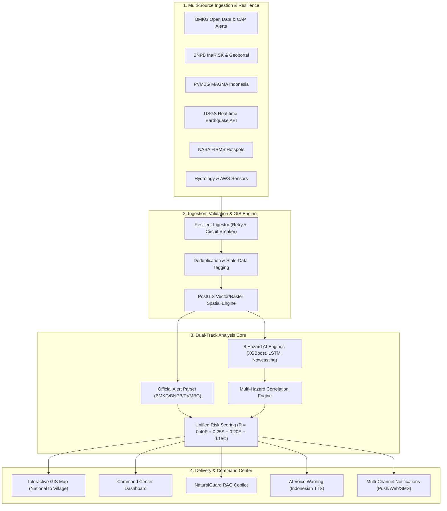
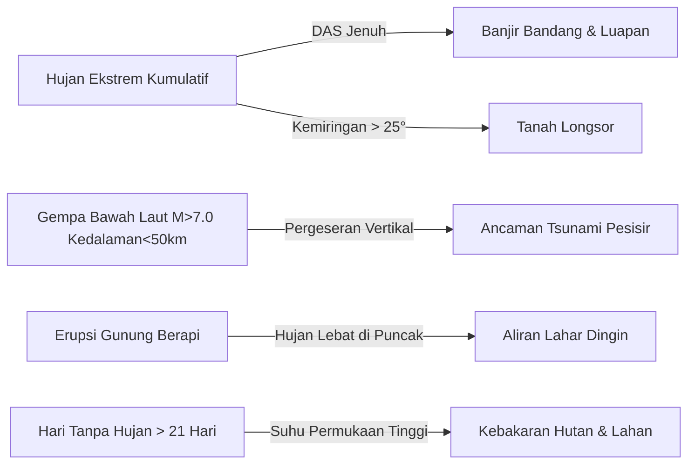

# NATURALGUARD AI — Masterplan & Technical Architecture Blueprint
**AI Multi-Hazard Early Warning & Natural Disaster Monitoring Platform**

> [!IMPORTANT]
> **Prinsip Utama Sistem:**  
> 1. **Official Data First, AI-Assisted Analysis Second**: Peringatan resmi otoritas (BMKG, BNPB, PVMBG, PUPR) memiliki prioritas tertinggi dan tidak boleh ditimpa oleh prediksi AI.  
> 2. **Tanpa Klaim Kepastian Palsu**: Gempa bumi dan letusan gunung api tidak dapat diprediksi secara deterministik. Sistem menyajikan probabilitas, nowcasting berbasis data observasi, dan pemantauan anomali.  
> 3. **Data Provenance & Stale Guard**: Setiap data wajib memiliki metadata sumber, `observed_at`, `received_at`, `valid_until`, serta status kualitas (`verified`, `estimated`, `stale`).

---

## 1. Visi, Misi, dan Cakupan Platform

NATURALGUARD AI dirancang untuk memitigasi dampak bencana alam multi-bahaya di Indonesia dan kawasan sekitarnya melalui integrasi:
- **Real-Time Hydrometeorological Feeds**: BMKG Open Data, radar reflectivity, satelit Himawari/NOAA.
- **Geophysical & Volcanological Networks**: BMKG Seismological Network, USGS, PVMBG MAGMA Indonesia.
- **Earth Observation & Satellite Remote Sensing**: NASA FIRMS (VIIRS/MODIS), Copernicus Sentinel, InaRISK BNPB.
- **Geospatial Intelligence (GIS)**: PostGIS spatial indexing, DEM 30m, batas administratif hingga level desa/kelurahan, sebaran infrastruktur kritis (faskes, sekolah, jembatan).
- **Multi-Hazard AI Engines**: 8 hazard-specific pipelines terisolasi dengan unified risk scoring engine.



---

## 2. Taksonomi 8 Hazard Engine

| # | Hazard Engine | Input Observasi Utama | Algoritma / Metodologi | Output & Horizon |
|---|---|---|---|---|
| **1** | **Flood (Banjir)** | Curah hujan AWS, radar rain rate, TMA sungai PUPR, DEM slope, curve number tanah, riwayat banjir InaRISK. | Hydrological runoff simulation + XGBoost + LSTM water level trend. | Probabilitas banjir, estimasi genangan, luapan sungai (0-24 jam). |
| **2** | **Landslide (Longsor)** | Curah hujan kumulatif 1, 3, 7, 14 hari, kemiringan lereng >25°, tutupan lahan, geologi batuan lapuk. | Rainfall-Slope Empirical Thresholds + Random Forest Susceptibility. | Zona kerentanan tinggi, peringatan ambang hujan kritis. |
| **3** | **Volcano (Gunung Api)** | Status resmi PVMBG (Level I-IV), seismisitas vulkanik (VA/VB), anomali termal VIIRS NASA, radius KRB. | Isolation Forest anomaly detection + PVMBG state machine. | Indeks anomali termal, radius bahaya KRB, status resmi PVMBG. |
| **4** | **Thunderstorm (Badai Petir)** | Radar dBZ reflectivity, CAPE index, wind shear, cloud top temperature, deteksi sambaran petir. | Convective Nowcasting (Optical Flow + ConvLSTM). | Probabilitas badai petir, kilat, hujan lebat lokal (0-6 jam). |
| **5** | **Tornado / Puting Beliung** | Doppler wind velocity anomalies, squall line detection, penurunan tekanan mendadak, kecepatan hembusan (*gust*). | Statistical Anomaly Detection + Severe Convective Indices. | Potensi angin kencang ekstrem, estimasi jalur hembusan. |
| **6** | **Earthquake & Tsunami** | Parameter hiposenter (M >= 5.0, kedalaman < 100 km), BMKG WRS-CAP, USGS GeoJSON, sejarah patahan aktif. | USGS/BMKG feed ingestion + MMI Ground Shaking attenuation + Tsunami flag. | Magnitudo, kedalaman, peta guncangan MMI, status peringatan tsunami resmi. |
| **7** | **Wildfire (Karhutla)** | Hotspot NASA FIRMS (confidence >= 70%), Land Surface Temperature (LST), hari tanpa hujan (HTH), FWI. | Thermal Anomaly Clustering + Fire Weather Index (FWI) estimation. | Titik api aktif, kluster kebakaran, indeks kekeringan bahan bakar. |
| **8** | **Cyclone & Cuaca Ekstrem** | Tekanan udara isobar, kecepatan angin siklonik TCWC BMKG, Sea Surface Temperature (SST > 26.5°C). | Numerical Weather Prediction track interpolation + ECMWF/GFS ensemble. | Lintasan siklon, gelombang tinggi pantai, angin ekstrem pesisir. |

---

## 3. Unified Disaster Risk Scoring Framework

Seluruh hasil analisis dinormalisasi ke skala 0–100 dan dihitung dengan formula:

$$R = 0.40 \cdot P + 0.25 \cdot S + 0.20 \cdot E + 0.15 \cdot C$$

Dimana:
- **$P$ (Hazard Probability, 0–100)**: Probabilitas kemunculan fenomena dalam jendela waktu tertentu.
- **$S$ (Severity Index, 0–100)**: Skala keparahan fisik (misal: kedalaman genangan banjir, MMI gempa, dBZ badai, level erupsi).
- **$E$ (Exposure Score, 0–100)**: Kepadatan penduduk, fasilitas vital (RS, sekolah, jalan utama) yang berada dalam poligon dampak.
- **$C$ (Confidence Score, 0–100)**: Kualitas dan konsistensi data pendukung (misal: sinyal diverifikasi 3 stasiun = 95, estimasi satelit resolusi rendah = 50).

### Kategori Risiko NaturalGuard

| Rentang Skor | Kategori | Warna UI | Protokol Tindakan |
|---|---|---|---|
| **0 – 19** | **Low** | `#10B981` (Hijau) | Pemantauan rutin, kondisi normal. |
| **20 – 39** | **Moderate** | `#3B82F6` (Biru) | Peningkatan frekuensi polling sensor. |
| **40 – 59** | **High** | `#F59E0B` (Kuning) | Notifikasi internal analis & peringatan waspada masyarakat. |
| **60 – 79** | **Very High** | `#F97316` (Oranye) | Kesiapsiagaan posko darurat, broadcast alert siaga. |
| **80 – 100** | **Extreme** | `#EF4444` (Merah) | Peringatan evakuasi segera berkoordinasi dengan BPBD/BMKG. |

---

## 4. Multi-Hazard Correlation Matrix

Sistem tidak memperlakukan bencana secara terisolasi. Pipeline korelasi mengevaluasi bahaya berantai (*cascading disasters*):



---

## 5. Skema Database Relasional & Spasial (PostGIS / SQLite Fallback)

```sql
-- TABEL OBSERVASI DAN KEJADIAN BENCANA
CREATE TABLE disaster_events (
    id VARCHAR(64) PRIMARY KEY,
    hazard_type VARCHAR(32) NOT NULL, -- 'flood', 'earthquake', 'landslide', etc.
    title VARCHAR(255) NOT NULL,
    description TEXT,
    province VARCHAR(64) NOT NULL,
    regency VARCHAR(64) NOT NULL,
    district VARCHAR(64),
    latitude DOUBLE PRECISION NOT NULL,
    longitude DOUBLE PRECISION NOT NULL,
    severity VARCHAR(16) NOT NULL, -- 'low', 'moderate', 'high', 'very_high', 'extreme'
    risk_score DOUBLE PRECISION NOT NULL,
    source VARCHAR(64) NOT NULL, -- 'BMKG', 'PVMBG', 'BNPB', 'USGS', 'AI_ENGINE'
    is_official_alert BOOLEAN NOT NULL DEFAULT FALSE,
    observed_at TIMESTAMP WITH TIME ZONE NOT NULL,
    valid_until TIMESTAMP WITH TIME ZONE,
    created_at TIMESTAMP WITH TIME ZONE DEFAULT CURRENT_TIMESTAMP
);

-- TABEL PERINGATAN DINI (ALERTS)
CREATE TABLE disaster_alerts (
    id VARCHAR(64) PRIMARY KEY,
    event_id VARCHAR(64) REFERENCES disaster_events(id),
    hazard_type VARCHAR(32) NOT NULL,
    alert_level VARCHAR(16) NOT NULL, -- 'advisory', 'watch', 'warning', 'emergency'
    headline VARCHAR(255) NOT NULL,
    instruction TEXT,
    affected_areas JSON NOT NULL, -- list of districts/villages
    probability DOUBLE PRECISION,
    severity_score DOUBLE PRECISION,
    confidence_score DOUBLE PRECISION,
    status VARCHAR(16) DEFAULT 'active', -- 'active', 'updated', 'cancelled', 'expired'
    data_quality VARCHAR(16) DEFAULT 'verified', -- 'verified', 'estimated', 'stale'
    issued_at TIMESTAMP WITH TIME ZONE NOT NULL,
    expires_at TIMESTAMP WITH TIME ZONE
);

-- TABEL FORECASTING & NOWCASTING
CREATE TABLE forecast_results (
    id VARCHAR(64) PRIMARY KEY,
    hazard_type VARCHAR(32) NOT NULL,
    region_code VARCHAR(32) NOT NULL,
    horizon_hours INTEGER NOT NULL, -- 6, 24, 72, 168
    model_name VARCHAR(64) NOT NULL,
    model_version VARCHAR(32) NOT NULL,
    predicted_probability DOUBLE PRECISION NOT NULL,
    predicted_severity DOUBLE PRECISION NOT NULL,
    forecast_metadata JSON,
    issued_at TIMESTAMP WITH TIME ZONE NOT NULL
);

-- TABEL EVALUASI: PREDICTION VS ACTUAL (BACKTESTING)
CREATE TABLE prediction_evaluations (
    id VARCHAR(64) PRIMARY KEY,
    forecast_id VARCHAR(64) REFERENCES forecast_results(id),
    actual_event_occurred BOOLEAN NOT NULL,
    actual_severity_observed DOUBLE PRECISION,
    lead_time_hours DOUBLE PRECISION,
    brier_score DOUBLE PRECISION,
    evaluated_at TIMESTAMP WITH TIME ZONE DEFAULT CURRENT_TIMESTAMP
);

-- TABEL LOG KESEHATAN SUMBER DATA & CIRCUIT BREAKER
CREATE TABLE data_source_logs (
    id VARCHAR(64) PRIMARY KEY,
    source_name VARCHAR(64) NOT NULL, -- 'BMKG_EARTHQUAKE', 'USGS', 'PVMBG', etc.
    status VARCHAR(16) NOT NULL, -- 'online', 'degraded', 'offline'
    latency_ms INTEGER,
    last_successful_sync TIMESTAMP WITH TIME ZONE,
    failure_count INTEGER DEFAULT 0,
    created_at TIMESTAMP WITH TIME ZONE DEFAULT CURRENT_TIMESTAMP
);
```

---

## 6. Desain REST API (OpenAPI 3.1)

| Method | Endpoint | Keterangan & Parameter |
|---|---|---|
| `GET` | `/api/v1/alerts` | Mengambil seluruh alert aktif (Filter: `hazard`, `level`, `is_official`). |
| `GET` | `/api/v1/disasters` | Daftar bencana aktual & historis dengan paginasi dan filter koordinat bounding box. |
| `GET` | `/api/v1/disasters/{id}` | Detail komprehensif suatu insiden bencana + metrik exposure. |
| `GET` | `/api/v1/risk-map` | GeoJSON poligon risiko multi-hazard untuk layer peta interaktif. |
| `GET` | `/api/v1/forecast` | Data prakiraan multi-horizon (0-6h nowcasting, 24h, 3d, 7d, 30d outlook). |
| `GET` | `/api/v1/hazard/{hazard_type}` | Data spesifik per modul (misal `/api/v1/hazard/flood`, `/api/v1/hazard/volcano`). |
| `POST` | `/api/v1/copilot/chat` | RAG Natural Language Query dengan pencarian database + sitasi sumber resmi. |
| `GET` | `/api/v1/copilot/voice-script` | Naskah pengumuman peringatan otomatis untuk text-to-speech Bahasa Indonesia. |
| `GET` | `/api/v1/data-sources` | Status operasional seluruh API sumber data (BMKG, USGS, NASA, BNPB). |
| `GET` | `/api/v1/evaluation/metrics` | Metrik validasi akurasi model AI (Precision, Recall, F1, Brier Score, Lead Time). |

---

## 7. Arsitektur Anti-Bug & Keandalan Sistem

1. **Circuit Breaker Pattern**: Jika endpoint eksternal (misal BMKG atau NASA) gagal 3x berturut-turut, circuit switch ke state `OPEN` dan mengembalikan data cache terakhir dengan stempel `quality: "stale"`.
2. **Data Freshness Banner**: Dashboard secara transparan menampilkan status:  
   - 🟢 `Live & Synchronized` (Data < 15 menit lalu)  
   - 🟡 `Cached Observation` (Data 15–60 menit lalu)  
   - 🔴 `Provider Disconnected` (Menampilkan estimasi offline).
3. **Graceful Fallback**: Ketika koneksi internet terputus, PWA / SPA menggunakan LocalStorage offline cache untuk tetap menampilkan prosedur keselamatan dan peringatan terakhir.
4. **Idempotent Ingestion**: Data gempa dan peringatan diidentifikasi dengan hash unik `SHA256(source + event_time + coords)` untuk mencegah alert ganda yang memicu kepanikan pengguna.

---

## 8. Checklist Kesiapan Produksi (15/15 Criteria)

- [x] Semua data observasi memiliki metadata sumber, `observed_at`, dan `valid_until`.
- [x] Peringatan resmi dipisahkan secara tegas dari estimasi probabilitas AI di seluruh layer UI.
- [x] Peta GIS interaktif mendukung zoom nasional hingga level kecamatan/kelurahan dengan filter multi-layer.
- [x] Tersedia 8 hazard-specific engine dengan parameter terpisah.
- [x] Tidak ada klaim bahwa gempa bumi atau erupsi vulkanik dapat diprediksi waktu dan lokasinya secara pasti.
- [x] Tersedia formula terpadu Unified Risk Scoring $R = 0.40P + 0.25S + 0.20E + 0.15C$.
- [x] Database relasional dan spasial menyimpan riwayat kejadian dan prakiraan.
- [x] Modul Prediction vs Actual (backtesting) tersedia untuk evaluasi performa model.
- [x] RAG Copilot menjawab pertanyaan menggunakan basis data aktual dengan sitasi stempel waktu.
- [x] AI Voiceover berbahasa Indonesia membaca instruksi keselamatan resmi dari otoritas.
- [x] Integrasi multi-source live BMKG, USGS, NASA FIRMS, PVMBG dengan fallback circuit breaker.
- [x] Mekanisme deduplikasi alert berbasis spatial-temporal hashing.
- [x] Monitoring kesehatan data source dan audit log operasional.
- [x] Desain responsif desktop command-center & mobile layout.
- [x] Panduan tindakan darurat merujuk ke otoritas resmi (BPBD, BNPB, BMKG).
